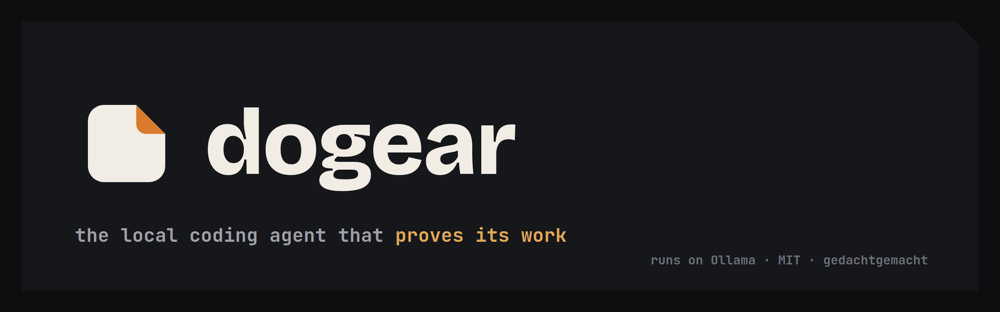
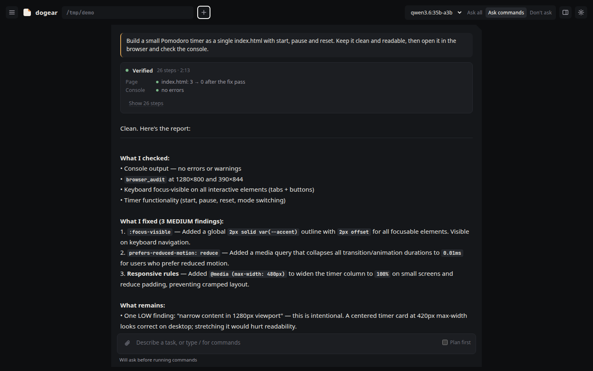
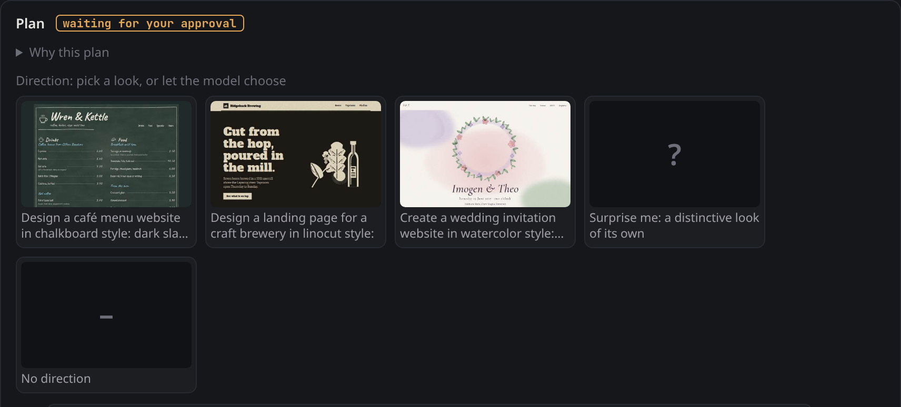
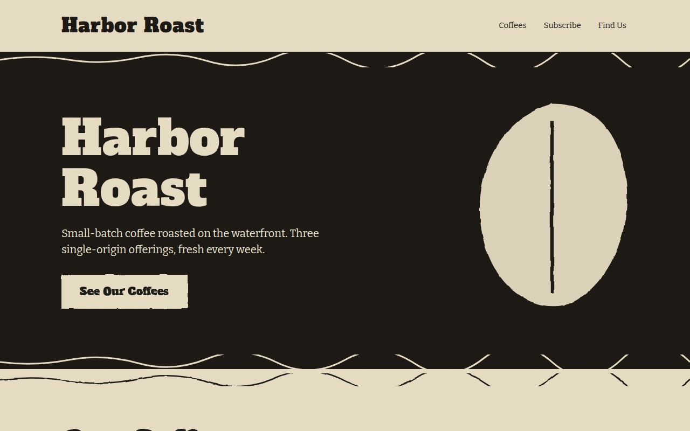
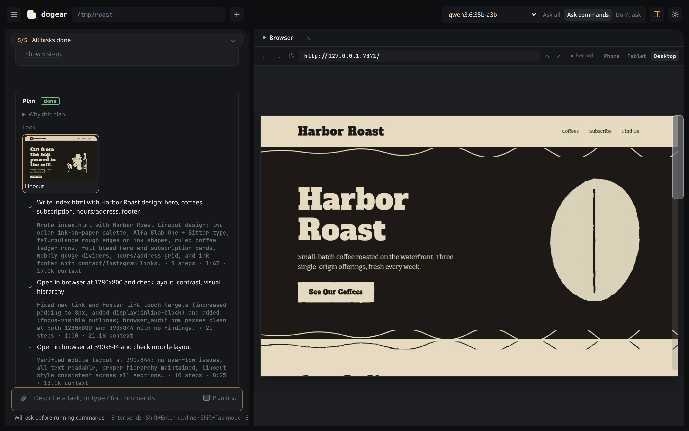
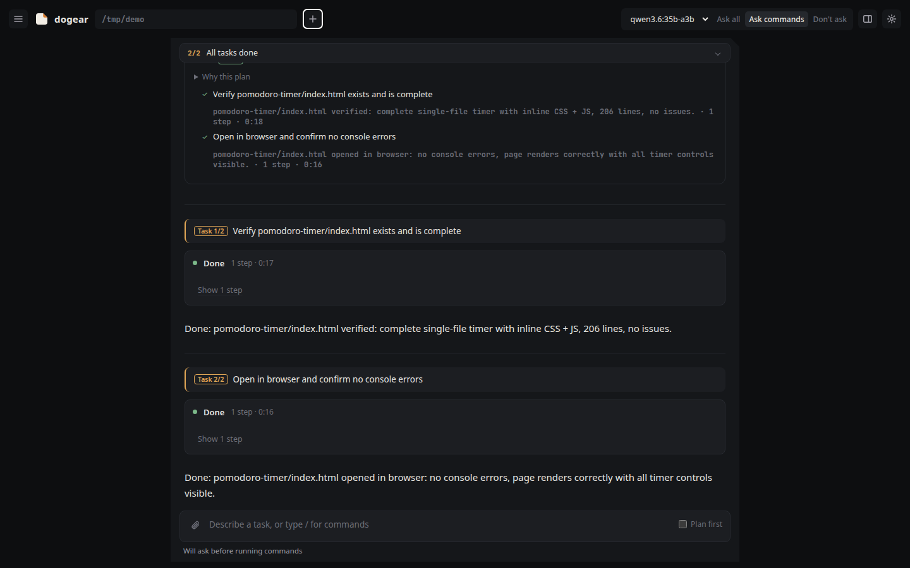

<p align="center">
  
</p>

# dogear

A coding agent that runs on your own machine, with a workspace you can watch, and a receipt for every run.

dogear talks to a local model through [Ollama](https://ollama.com), gives it the tools a coding agent needs (read, write, edit, search, shell, tests, git, a real browser), and shows you what it does while it does it: files being typed, diffs, the terminal, and a live browser that you and the agent share. Nothing leaves your machine unless the agent opens a web page, or you choose a remote model for a project (see [Remote models](#remote-models)).

<p align="center">
  
</p>

## What it does

- **Claude Code style tools.** `Read`, `Write`, `Edit`, `MultiEdit`, `Glob`, `Grep`, `LS`, `Bash` (with background processes), `RunTests`, `Git`, `Outline`, `FindSymbol`, `WebSearch`, `WebFetch`, `TodoWrite`, `Task` (sub-agent), `AskUser` (multiple-choice forms) and more. Names and shapes follow the Claude Code conventions, so models that learned them use them well.
- **A browser you both control.** Headless Chrome with its own profile, driven over the DevTools protocol by a small built-in client. The agent navigates, reads the page as element refs, clicks and types; you watch the screencast in the UI and can take over at any time. CAPTCHAs and logins are never bypassed: the agent hands over to you.
- **One status block per turn.** Working (with the current step and a Stop button), Waiting for you (the permission question or the model's form, right there), Checking the result, Done or Stopped. The steps underneath stay folded; the answer is rendered once and never re-laid out.
- **The receipt.** When a run ends, the harness reports what it knows itself: the tests it saw run, the page it measured (before and after the fix pass), console errors it caught, and a status it computed, not the model: Verified, Unverified, Stopped.
- **Flows: show, don't tell.** Press Record in the browser panel, do the thing on the page, name it. The steps (clicks, typing, navigation, with locators that survive a reload) are saved in the project; the agent replays them with `browser_flow` ("do this for the other twenty products"), and a flow marked as a check runs after every change to web files and shows up on the receipt.
- **Live workspace, on demand.** Open it when the status block offers something to look at ("Open index.html", "Watch the browser"); nothing opens on its own. New files are typed in line by line, edits are shown as diffs, shell output streams into the Output panel, a preview server serves the project on a separate origin.
- **Three modes, named by what they ask.** Ask all (every edit and command), Ask commands (edits run, commands ask), Don't ask.
- **Plan first.** A toggle on the composer: the model investigates with read-only tools and proposes a task board. You edit, approve or reject it. Then the harness hands the model one task per turn; the model closes each task with a one-line summary or asks for a new plan when something does not fit. Every task runs in a fresh, small context (request, board, changed files, the task itself), is logged on the plan card with its context size, the task strip above the chat shows where the run is, and the self-check and quality gate run once, after the last task.
- **Undo.** Every run starts with a shadow checkpoint of the project (a git commit under `refs/dogear/...`, never touching your branches). One click puts the files back.
- **Edit and retry.** Hover a message, edit it and send it again as a new session based on this one; compare the two side by side, keep the files of the one you like. Parallel variants (two to four sessions in their own git worktrees) can be switched on in the settings.
- **Quality gate for web work.** After changes to HTML/CSS/JS the harness measures the page itself (overflow, contrast, holes in grids, empty boxes, tiny targets, placeholder images, generated-UI tells) at desktop and phone width and starts a fix pass when it finds something. Optionally a copy check proofreads the visible text against the brief.
- **Direction before the page.** For a web brief planned with Plan first, the approval card shows pictures of the three most similar solved briefs from a library of 300 design plans. Pick one (its palette, type and signature move go into every task briefing), say "surprise me", or none. The audit measures defects; this is the cheap way to get taste.

<p align="center">
  
</p>

<p align="center">
  
  <br><sub>The result of that plan with the linocut direction picked: built by qwen3.6:35b-a3b in two tasks, 4 minutes, audit clean at desktop and phone width.</sub>
</p>
- **Memory.** Notes the agent keeps (decisions, gotchas, commands, preferences) per project (`<project>/.dogear/`) or globally.
- **Skills.** Markdown skill files with triggers (`skills/*.md`, plus `<project>/.dogear/skills/`) are loaded into the prompt when the task matches: web design, debugging, testing, code review, API design, security review and more.
- **MCP.** Connect any MCP server over stdio or Streamable HTTP; its tools appear to the model as `mcp__<server>__<tool>`.
- **Model profiles, with numbers.** Every model is recognised the first time it is used (size, MoE, tools, vision, reasoning) and gets a toolbox and prompt style that fits it. The Models pane (settings) shows what dogear measured: tokens per second, how often the model slipped on tool calls, the toolbox in use, and a warning when the chosen context is larger than the model supports. Small models get a lean toolbox and rescue logic for tool calls they write as text.
- **Context care.** `/compact` condenses the conversation into a briefing; it happens automatically when the context window is 70 % full. Images can be attached, pasted or dropped.

<p align="center">
  
</p>

<p align="center">
  
</p>

## Quick start

You need Python 3.12+, [uv](https://docs.astral.sh/uv/), [Ollama](https://ollama.com) with at least one tool-capable model, and Chrome or Chromium for the browser features.

```sh
ollama pull qwen3.6:35b-a3b      # the default model; any tool-capable model works
git clone https://github.com/gedachtgemacht/dogear
cd dogear
uv run python -m dogear --open   # http://127.0.0.1:7870
```

`./start.sh` does the same. `uv run python -m dogear --help` lists the options (`--port`, `--root`, `--reload`).

Point the project field in the header at a directory, pick a mode, describe a task. Type `/` in the composer for commands (`/plan`, `/compact`, `/remember`, `/init` …). Shift+Tab cycles the mode, Esc stops a run.

To start dogear at login and get a launcher in the application menu (Linux with systemd):

```sh
scripts/install-desktop.sh          # scripts/install-desktop.sh --remove undoes it
```

### Models

dogear works with every Ollama model that supports tool calls. On a laptop with 30 GB of shared memory the defaults are:

| Role | Model | Why |
|---|---|---|
| main | `qwen3.6:35b-a3b` | 7/7 on the benchmark at ~70 tokens/s |
| helper (titles, suggestions, fast sub-agents) | `qwen3.5:4b` | small and quick; chosen automatically as the smallest installed tool model |
| embeddings (design library) | `qwen3-embedding:0.6b` | optional; without it the library falls back to keyword search |

Models with vision get screenshots; models without are told they cannot see the attached image. `scripts/calibrate.py MODEL` measures which toolbox size a new model handles best and records it.

### Remote models

Local first, remote by choice. A model behind an OpenAI-compatible API (OpenRouter, MiniMax, Groq, Together, …) can be added next to the Ollama models:

```bash
cp providers.example.json providers.json     # which providers and models; both files are gitignored
echo 'OPENROUTER_API_KEY=sk-or-…' > .env     # the key, read from .env or the environment, written nowhere else
```

The model then appears in the menu as `openrouter/minimax/minimax-m3.1-flash · remote`. The first time you use it in a project, dogear asks once: everything the agent reads there (files, command output, screenshots) is sent to the provider while that model is selected. The answer is remembered per project in `data/settings.json`. The helper model, embeddings and the design library always stay local. What the provider charges is shown next to the context meter when it reports it (OpenRouter does), and in the benchmark table: `uv run python scripts/bench.py qwen3.6:35b-a3b openrouter/minimax/minimax-m3.1-flash` runs the same tasks on both.

### Project instructions

If the project root contains a `DOGEAR.md` (also `CLAUDE.md` or `AGENTS.md`), its content goes into the system prompt. `/init` asks the agent to write one.

### MCP servers

`mcp.json` in the dogear directory (global) or `.mcp.json` in the project, the same shape Claude Code uses:

```json
{"mcpServers": {
  "files":  {"command": "npx", "args": ["-y", "@modelcontextprotocol/server-filesystem", "."]},
  "remote": {"url": "http://127.0.0.1:8080/mcp", "headers": {"Authorization": "Bearer …"}}
}}
```

MCP tools always ask for permission outside Auto mode.

## How it is built

No build step, no framework on the front end, few dependencies on the back end.

```
dogear/          the Python package
  server.py      FastAPI: HTTP API, WebSocket, the preview server on a second port
  agent.py       the agent loop: prompt, model → tool calls → permissions → results → model, review pass, quality gate
  tools.py       built-in tools and the browser tools; permission classes (read / write / shell / net / browser)
  browser.py     Chrome over the DevTools protocol: screencast, input, reading the page, consent dialogs, hand-over
  devtools_*.py  MultiEdit, Outline, FindSymbol, RunTests, Git
  planning.py    the plan phase and the approval board
  checkpoint.py  shadow checkpoints and undo
  worktrees.py   parallel variants in git worktrees
  memory.py      notes, snippets and learned skills
  library.py     the snippet library with embeddings
  profiles.py    model detection, toolbox and prompt selection, issue statistics
  audit.py       the measured visual audit and the static source checks
  copycheck.py   proofreading of page copy against the brief
  present.py     turns a finished answer into display blocks
  ultra.py       a multi-agent orchestrator (kept, not offered to the model)
  mcp.py         MCP client, stdio and Streamable HTTP
  learning.py    what a run teaches the library, and when that is taken back
  llm.py         streaming client for Ollama; hands <provider>/<id> names to remote.py
  remote.py      remote models over an OpenAI-compatible API (providers.json, .env), opt-in per project
web/             the UI: index.html, style.css and six plain scripts (core, sidebar, chat, workspace, board, app)
skills/          built-in skills (skills/extra: more, not loaded by default)
scripts/         benchmark, calibration, design benchmark, screenshots, run a task from the shell
tests/           pytest entry (test_checks.py), the check scripts, live end-to-end scripts, fixtures
data/            runtime state (sessions, images, Chrome profile, library, learned skills); not in git
projects/        default workspace for new sessions; not in git
```

[docs/ARCHITECTURE.md](docs/ARCHITECTURE.md) describes the agent loop, the WebSocket protocol, the permission model and the data on disk in more detail.

### Safety model

- The server binds to `127.0.0.1` only, and the WebSocket accepts connections only from the page it served (Origin check), so no other web page can drive the agent.
- Project files are served from a second origin (port 7871); pages the agent writes or visits can never reach the agent's API.
- Tools stay inside the project directory. `sudo`, `rm -rf /` and similar are refused in every mode.
- The shell runs with a cleaned environment, so the agent cannot install into dogear's own virtualenv.
- The browser never solves CAPTCHAs, logins or 2FA; it hands over to you. Cookie banners are dismissed with the most restrictive option.
- Secrets (keys, tokens, passwords) are refused by the memory and library tools.

## Tests

```sh
uv run pytest                              # the check scripts that run on this machine (browser, model and dataset checks skip when missing)
uv run python tests/check_skills.py        # any check on its own
uv run python tests/live/ws_smoke.py       # the WebSocket handlers without a model: needs the server on 7870
uv run python tests/live/smoke.py          # end-to-end scripts: need the server and the models
uv run python scripts/bench.py             # benchmark all installed models on small coding tasks
```

## Status

dogear is a personal tool, built in a few weeks, in daily use with local models. It is complete enough to be useful and small enough to read in an afternoon. Things that are known to be rough: visual judgement of the models themselves is weak (that is why the audit measures instead of asking), small models vary a lot between runs, and parallel variants share one browser.

## Brand

The mark is a folded page corner (a dog-ear), the one visual signature of the UI: every panel has that cut corner. Files in `docs/brand/`: `mark.svg`, `banner.png`, `social.png`. One accent colour, amber `#e3a857` on dark and `#b36d12` on light; everything else is grey.

## License

MIT. Built by [gedachtgemacht](https://gedachtgemacht.app).
